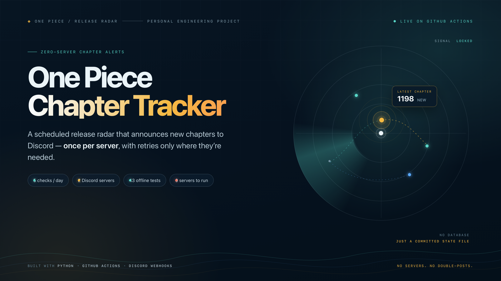
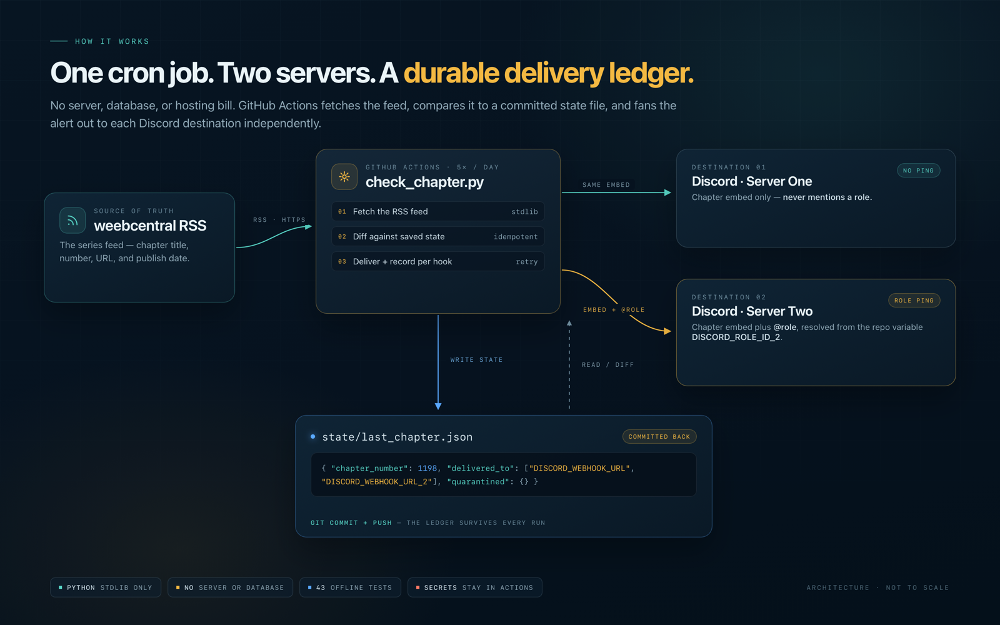
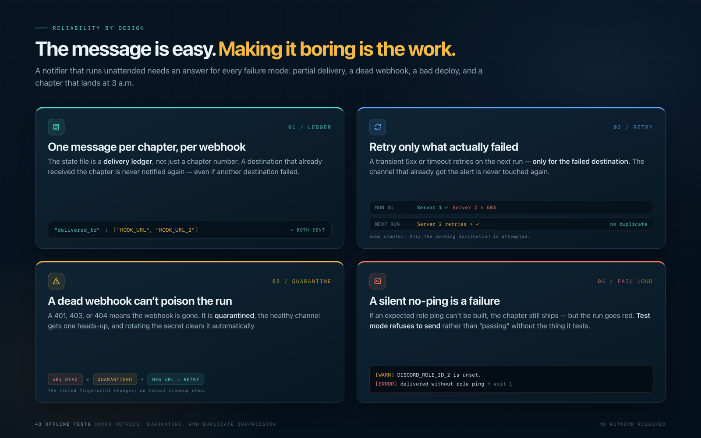
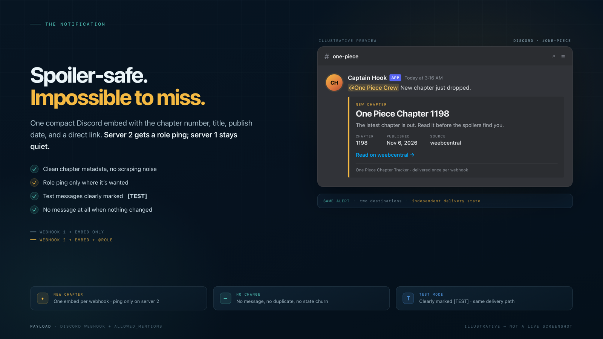

# One Piece Chapter Tracker

**A zero-server Discord release radar for new One Piece chapters.**



---

## Quick copy

Use these as-is, or trim to fit a showcase form.

**Project name:** One Piece Chapter Tracker

**Tagline:** A zero-server Discord release radar for new One Piece chapters.

**One-liner:**
A GitHub Actions bot that checks the One Piece RSS feed five times a day and announces new chapters to two Discord servers — once per server, with retries only where they’re needed.

**Short description (≈45 words):**
A zero-server Python bot on GitHub Actions that detects new One Piece chapters from the series RSS feed and posts a clean Discord embed to two servers. Per-webhook delivery tracking prevents duplicate alerts, retries target only the webhook that failed, and dead webhooks are quarantined automatically.

**Long description (≈150 words):**
One Piece Chapter Tracker is a small, production-minded automation project: a Python script on a GitHub Actions cron that runs five times a day. It reads the series RSS feed, compares the latest chapter against a committed state file, and sends a Discord embed to two servers when something new lands. The first server gets a quiet alert; the second gets the same alert plus a role ping, configured as a repository variable rather than hardcoded.

The interesting work is in the failure paths. The state file is a per-destination delivery ledger, so a failed webhook can’t cause duplicate messages in a channel that already succeeded. Transient errors retry only where needed, permanently dead webhooks are quarantined, and a missing role ping turns the run red instead of failing silently. No server, database, or paid hosting — just the Python standard library, a cron job, and 43 offline tests.

**Tech tags:**
`Python` · `GitHub Actions` · `Discord Webhooks` · `RSS / XML` · `urllib` · `unittest` · `Git-as-state`

---

## At a glance

| | |
|---|---|
| **Schedule** | 5 checks per day (GitHub Actions cron) |
| **Destinations** | 2 Discord servers, tracked independently |
| **Infrastructure** | 0 servers, 0 databases, 0 hosting bills |
| **State** | One committed JSON ledger |
| **Role ping** | Server 2 only, via `DISCORD_ROLE_ID_2` repo variable |
| **Tests** | 43 offline unit tests, no network required |
| **Runtime** | Python standard library only |

---

## The problem

One Piece chapters don’t arrive on a convenient schedule. Checking a scanlation site manually means refreshing at the wrong times, and a plain RSS-to-Discord bridge is too blunt: two servers wanted the alert, but only one wanted a role ping. The tracker also had to survive the boring failure modes — a flaky feed, a deleted webhook, a bad config — without spamming a channel or silently going dark.

The constraint was simple: **no server to maintain.** GitHub Actions provides the scheduler, the repo provides durable state, and Discord webhooks provide delivery.

---

## What it does

- Checks weebcentral’s One Piece RSS feed on a cron, five times a day.
- Compares the latest chapter with `state/last_chapter.json`.
- Posts a Discord embed with the chapter number, title, publish date, and a direct link.
- Sends the same alert to a second server with **one role ping**; the first server stays mention-free.
- Records delivery **per webhook**, so a partial failure can never double-post the channel that succeeded.
- Retries only the destination that failed, on the next scheduled run.
- Quarantines webhooks that return 401/403/404, with a one-time heads-up in the surviving channel.
- Fails loudly on feed errors and misconfiguration; `--send-test` refuses to “pass” without the ping it is meant to verify.

---

## How it works



1. **GitHub Actions wakes up** on the cron schedule (or a manual dispatch).
2. **`check_chapter.py` fetches the RSS feed** and extracts the latest chapter title, number, URL, and publish date.
3. **It reads the committed state ledger.** If the chapter is already recorded, it exits without sending anything.
4. **It builds the payload per destination.** Webhook 1 gets the embed; webhook 2 gets the embed plus `<@&role>` and an explicit `allowed_mentions` block so Discord actually notifies the role.
5. **It records each success independently** in `delivered_to`, then commits the state file back to the repo with `[skip ci]`.
6. **If a destination failed,** only that destination is pending on the next run. If it failed permanently, it is quarantined instead.

The workflow uses a `concurrency` group and a `git pull --rebase` before pushing state, so two overlapping runs can’t race each other into a duplicate notification.

---

## The hard part: making delivery boring



A notifier is easy to demo and hard to leave unattended. The design treats the state file as a **delivery ledger**, not a single “last chapter” number.

| Situation | What happens |
|---|---|
| No new chapter | Exit `0`, send nothing, leave state untouched |
| New chapter, both webhooks healthy | Send once to each, record both, commit state |
| Webhook A succeeds, webhook B gets a 5xx/timeout | Record A; retry **only B** next run; A is never re-notified |
| Webhook returns 401/403/404 | Quarantine it, alert the surviving channel once, keep the run green |
| Webhook URL is replaced | The stored fingerprint changes, so the quarantine clears and delivery resumes automatically |
| Feed unreachable or unparsable | Exit `1` with a loud `[ERROR]`; do **not** treat it as “no new chapter” |
| Expected role ping is unset or invalid | Deliver the chapter without the ping, log `[WARN]`, then exit `1` so the run goes red |
| Test mode with a broken role config | Refuse to send anything and exit `1` — a test can’t pass without the thing it tests |

The quarantine stores a truncated SHA-256 fingerprint of the webhook URL, never the URL itself. Webhook URLs stay in GitHub Actions secrets; the state file only knows the environment-variable names.

---

## The notification



The alert is deliberately small: one embed, one link, no scraping noise. The second server gets a role mention above the embed; the first gets the same card without a ping. Test sends are clearly marked `[TEST]` and never touch the chapter state, so a test can’t swallow the next real release.

*(The Discord image is an illustrative mockup, not a live screenshot.)*

---

## Testing

The suite is fully offline — the network layer is faked, so the tests run in milliseconds and don’t depend on Discord or the feed being available.

```bash
python3 -m unittest discover -s tests -v
# Ran 43 tests ... OK
```

Coverage focuses on the parts that are easy to get wrong:

- per-webhook delivery tracking and duplicate suppression;
- retrying only the failed destination;
- quarantine behavior, including automatic recovery after a URL change;
- missing, malformed, and valid role-ping configuration;
- `--send-test` refusing to send without an expected ping;
- feed failures remaining loud instead of becoming “no new chapter”;
- state migration for older files without the new fields.

There are also operator-facing modes for the real environment:

```bash
python3 scripts/check_chapter.py --dry-run          # fetch and print, no side effects
python3 scripts/check_chapter.py --check-webhooks   # GET each webhook, send nothing
python3 scripts/check_chapter.py --send-test        # real delivery path, marked [TEST]
```

---

## Security and operations

- **Webhook URLs live only in GitHub Actions secrets.** They are never written to the repo or the state file.
- **The role ID is a repository variable, not a secret.** It isn’t sensitive, and keeping it in `vars` makes the workflow’s config explicit.
- **The Discord role must be mentionable** (Role settings → Display → Allow anyone to @mention this role) for the ping to notify members.
- **The state file stores env-var names and an optional fingerprint**, not credentials.
- **The workflow has `contents: write`** only because it commits the updated state; the token is the scoped `GITHUB_TOKEN`.
- **Failures are visible.** A broken feed or missing ping turns the Actions run red; the workflow still commits state first, so a retry doesn’t re-notify channels that already succeeded.

---

## Decisions worth talking about

**RSS instead of HTML scraping.** The series page exposes a per-series RSS feed with clean titles, URLs, and dates. It removes the CSS-selector fragility of scraping and leaves one small parsing surface to maintain.

**Git as the database.** A single committed JSON file is enough for this workload: it is durable, auditable, free, and easy to inspect. The trade-off is a state commit on every new chapter — solved with a concurrency group and a rebase-before-push.

**Per-destination state, not one boolean.** The first version could have stored “announced: true.” Tracking each webhook independently is what makes partial failure safe: the channel that succeeded is never punished for the one that didn’t.

**Fail closed in test mode.** A test send that reports success without the role ping is worse than no test. `--send-test` now refuses to send when the expected ping can’t be built, and a real run exits non-zero after delivering.

---

## What I learned

The visible feature is “post a Discord message.” The actual engineering is **failure semantics**: deciding what a missing feed, a dead webhook, a partial success, and a bad config each mean, then making those meanings consistent in code, logs, exit codes, and tests. Once those are explicit, the happy path becomes almost boring — which is the point.

---

## Links and media

**Repository:** [github.com/raYhanryd/onepiece-tracker](https://github.com/raYhanryd/onepiece-tracker)

**Live demo:** Not applicable; it runs as a scheduled GitHub Actions workflow with private Discord credentials. The alert mockup above shows the delivered result.

### Image files

Keep the `images/` folder alongside this file when copying the overview.

| File | Size | Use |
|---|---|---|
| `images/cover.png` | 1600 × 900 | Hero / project card |
| `images/architecture.png` | 1600 × 1000 | “How it works” section |
| `images/reliability.png` | 1600 × 1000 | Engineering deep-dive |
| `images/alert.png` | 1600 × 900 | Product/result section |

### Alt text and captions

- **Cover:** “One Piece Chapter Tracker — a zero-server Discord release radar, with a radar graphic showing the latest chapter.”
- **Architecture:** “A GitHub Actions cron reads the weebcentral RSS feed, compares a committed state ledger, and delivers an embed to two Discord webhooks — one quiet, one with a role ping.”
- **Reliability:** “Four reliability features: a per-webhook delivery ledger, targeted retries, dead-webhook quarantine, and loud configuration failures.”
- **Alert:** “Illustrative Discord alert showing a role mention above a One Piece chapter embed, with message states for new chapter, no change, and test mode.”
